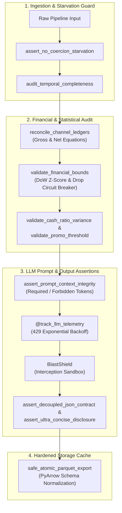

# System Architecture & Design Specification

`ai-ops-eval-harness` is an SRE-hardened evaluation harness and operational circuit breaker engine designed for autonomous AI agents, financial reconciliation pipelines, and critical operational workflows.

---

## 1. Core Architectural Tenets

1. **Fail-Closed on Financial Variance & Starvation:**
   If ingested data drops records beyond tolerance thresholds or ledger equations fail reconciliation, the pipeline halts immediately with actionable diagnostic exceptions (`DataStarvationError`, `FinancialAnomalyError`).
2. **Blast Radius Isolation (`BlastShield`):**
   External dispatch side effects (e.g., messaging, webhooks, alerting) are intercepted during evaluation runs to prevent inadvertent production pollution.
3. **Decoupled JSON Contracts:**
   Agent outputs are validated against strict contracts forbidding unparsed stack traces, raw error markup (`<ERROR>`), or deprecated media tags.
4. **Progressive Disclosure Enforcement:**
   Outputs must remain concise by default; markdown tables or multi-bullet expansions require explicit user prompt intent.
5. **Deterministic Serialization & Schema Swapping:**
   Recursive serialization sanitizes NumPy and Pandas types (including `NaT`, `NaN`, and object types) before JSON delivery or Parquet caching.

---

## 2. End-to-End Evaluation Lifecycle

---

## 3. Subsystem Breakdown

### A. Assertion Engine (`assertions.py`)
- **`audit_temporal_completeness`**: Verifies time-series density against expected date windows, flagging partial or fatal starvation.
- **`assert_decoupled_json_contract`**: Verifies that LLM outputs parse as valid JSON dictionaries containing status and text without leaking traceback strings.
- **`assert_ultra_concise_disclosure`**: Enforces telegraphic executive summaries (max 4 bullets) unless expansion keywords (`detallado`, `desglose`, `tabla`) are supplied.
- **`assert_prompt_context_integrity`**: Guarantees system prompt prompts contain necessary operational context tokens and lack blacklisted markers.

### B. Financial Auditor (`auditor.py`)
- **`reconcile_channel_ledgers`**: Validates multi-channel equations:
  $$\text{Secondary Net} = \text{Gross} - \text{Tax} - \text{Fees} \pm \epsilon$$
  where $\epsilon \le 0.01$ (IEEE 754 float tolerance).
- **`validate_financial_bounds`**: Computes day-of-week historical baseline mean $\mu$ and standard deviation $\sigma$. Flags anomalies where:
  $$|Z| = \frac{|x - \mu|}{\sigma} > 3.0 \quad \lor \quad \frac{x - \mu}{\mu} < -0.90$$
  Includes a T-1 grace period to skip incomplete current-day records.
- **`safe_atomic_parquet_export`**: Hardens Parquet exports by coercing untyped object columns to strings and writing to temporary swap files before atomic rename, failing open on read-only filesystems.

### C. Scenario Harness & Sandboxing (`scenarios.py`)
- **`BlastShield`**: Context manager intercepting external outbound communications, storing payload history without transmitting network packets.
- **`ScenarioHarness` & `QAScenario`**: Declarative execution engine running registered test suites, timing scenario duration, catching unexpected exceptions, and generating consolidated JSON reports.

### D. Telemetry Decorator (`telemetry.py`)
- **`@track_llm_telemetry`**: Intercepts LLM inference invocations, records total token counts, handles HTTP 429 rate limits with exponential backoff (2s, 4s, 8s), and dispatches webhook alerts upon retry exhaustion.

### E. CLI Entrypoint (`cli.py`)
- Command-line tool `ai-ops-eval` exposing `eval`, `reconcile`, and `starvation-check` subcommands for headless CI/CD integration and operator inspection.
