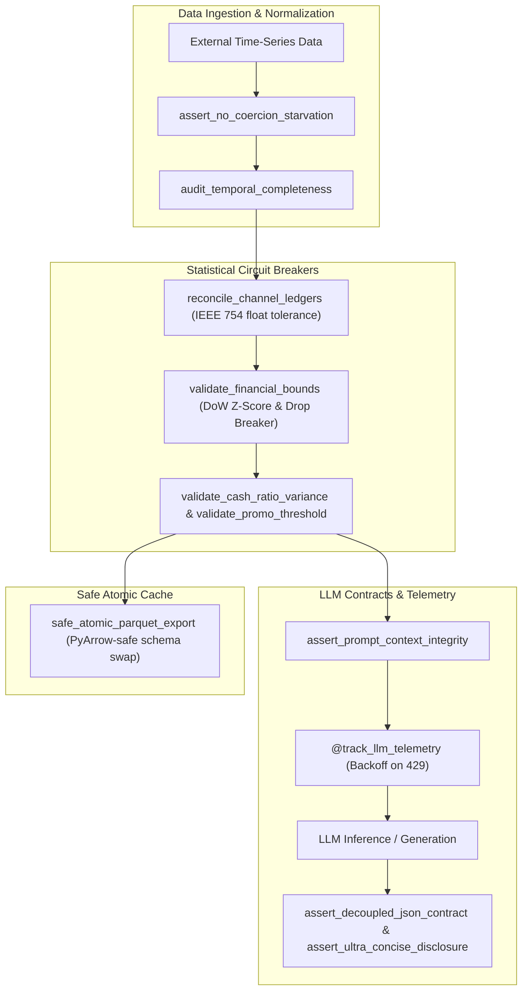

# ai-ops-eval-harness 🧪

[](https://github.com/emmanuelol/ai-ops-eval-harness/actions/workflows/ci.yml)
[](https://opensource.org/licenses/MIT)
[](https://www.python.org/downloads/)

SRE-hardened evaluation harness, deterministic QA scenario runner, LLM prompt/output contract assertions, and statistical circuit breakers for automated financial and operational pipelines.

---

## 🏛️ Architecture & Evaluation Flow



---

## 🛡️ SRE Circuit Breaker Matrix

| Mechanism | Trigger Condition | Default Action | Error / Metric |
|---|---|---|---|
| **Zero-Tolerance Starvation** | Dropped 100% records or drop > threshold | Immediate fail-closed exception | `DataStarvationError` |
| **Channel Ledger Reconciliation** | Reported Net != Gross - Tax - Fees | Detect hidden variance, fail if > abs_tol | `FinancialAnomalyError` |
| **Contextual DoW Anomaly** | \|Z-Score\| > 3.0 or drop > 90% | Anomaly quarantine halt (with T-1 grace period) | `FinancialAnomalyError` |
| **Cash Ratio Spike** | Z-Score > 2.0 vs 30-day baseline | Flags payment fraud/divergence anomaly | `FinancialAnomalyError` |
| **Promo Cannibalization** | Promo Share > 8.0% | Anomaly trip on marketing margin leak | `FinancialAnomalyError` |
| **PyArrow Cache Hardening** | Object columns in Parquet | Automatic string coercion & atomic temp-swap | Fail-open on `OSError` |
| **LLM Rate-Limit Backoff** | HTTP 429 or Resource Exhausted | Exponential backoff (2s, 4s, 8s) + alert webhook | `track_llm_telemetry` |
| **Progressive Disclosure UX** | Markdown tables without keywords | Rejects verbose wall-of-text | `EvalAssertionError` |

---

## 🚀 Quickstart

### 1. Installation
```bash
pip install ai-ops-eval-harness
```

### 2. Reconciliation & Starvation Check
```python
from ai_ops_eval_harness import (
    assert_no_coercion_starvation,
    reconcile_channel_ledgers,
    FinancialAnomalyError,
)

# Guard against silent coercion drops
assert_no_coercion_starvation(initial_count=100, final_count=100)

# Reconcile multi-channel ledgers with float precision tolerance
reconciliation = reconcile_channel_ledgers(
    primary_gross=12000.50,
    secondary_gross=3500.00,
    secondary_net=2800.00,
    secondary_tax=400.00,
    secondary_fee=300.00,
    platform_estimate=2800.00,
    abs_tol=0.01,
)
print(f"Consolidated Gross: ${reconciliation['consolidated_gross']}")
```

### 3. Declarative Scenario Runner
```python
from ai_ops_eval_harness import (
    ScenarioHarness,
    QAScenario,
    BlastShield,
    assert_decoupled_json_contract,
)

harness = ScenarioHarness(name="daily_eval")

def sample_pipeline():
    with BlastShield(simulate_success=True) as shield:
        # Simulate dispatching report
        shield.record_dispatch("+1234567890", {"message": "All systems operational"})
        return {"status": "success", "text": "Daily summary"}

harness.register(
    QAScenario(
        name="daily_health_check",
        description="Verifies pipeline produces decoupled JSON",
        runner=sample_pipeline,
        assertions=[assert_decoupled_json_contract],
    )
)

report = harness.run_all()
print(f"Passed: {report['passed']}/{report['total_scenarios']}")
```

---

## 🧪 Verification & Security Audit

This repository enforces 100% containerized execution and Trivy vulnerability auditing:

```bash
# Build Docker image
make build

# Run unit and integration tests inside container
make test

# Scan image for vulnerabilities and prohibited secrets
make audit
```
