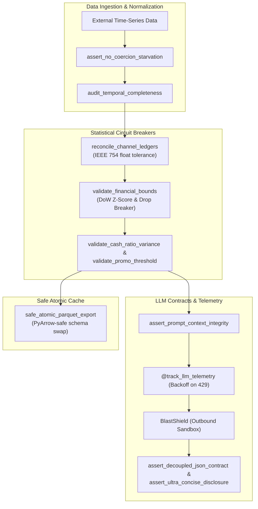

# ai-ops-eval-harness 🧪

[](https://github.com/emmanuelol/ai-ops-eval-harness/actions/workflows/ci.yml)
[](https://github.com/emmanuelol/ai-ops-eval-harness/releases)
[](https://www.python.org/downloads/)
[](https://github.com/astral-sh/uv)
[](https://peps.python.org/pep-0561/)
[](https://opensource.org/licenses/MIT)

SRE-hardened evaluation harness, deterministic QA scenario runner, LLM prompt/output contract assertions, and statistical circuit breakers for automated financial and operational pipelines.

---

## ⚡ 30-Second Quick Tour

### Zero-Install Execution (`uvx`)
Run directly from GitHub without cloning or setting up a virtual environment:
```bash
uvx --from git+https://github.com/emmanuelol/ai-ops-eval-harness ai-ops-eval eval --json
```

### CLI Evaluation & Real Terminal Outputs
```bash
# 1. Execute evaluation harness and get instant structured report
$ ai-ops-eval eval
=== Evaluation Harness: cli_evaluation_suite ===
Total Scenarios : 1
Passed          : 1
Failed          : 0
  ✅ system_contract_eval (0.0000s)

# 2. Output clean JSON report for machine consumption
$ ai-ops-eval eval --json
{
  "harness": "cli_evaluation_suite",
  "total_scenarios": 1,
  "passed": 1,
  "failed": 0,
  "success_rate_pct": 100.0,
  "duration_seconds": 0.0,
  "results": [
    {
      "name": "system_contract_eval",
      "passed": true,
      "duration_seconds": 0.0,
      "error": null
    }
  ]
}

# 3. Reconcile multi-channel ledgers with IEEE 754 precision tolerance
$ ai-ops-eval reconcile \
  --primary-gross 12500 \
  --secondary-gross 3200 \
  --secondary-net 2624 \
  --secondary-tax 416 \
  --secondary-fee 160
=== Reconciliation Succeeded ===
Consolidated Gross: 15700.00
Primary Gross     : 12500.00
Secondary Gross   : 3200.00
Secondary Net     : 2624.00
Gross Variance    : 0.0000
Net Variance      : 0.0000
Hidden Variance   : 0.0000

# 4. Audit data ingestion coercion drops against tolerance threshold
$ ai-ops-eval starvation-check --initial 1000 --final 995 --tolerance-pct 1.0
STARVATION CHECK PASSED: initial=1000, final=995
```

---

## 🏛️ Architecture & Evaluation Flow

For full architectural deep-dive and subsystem specifications, see [ARCHITECTURE.md](ARCHITECTURE.md).



---

## 🛡️ SRE Circuit Breaker Matrix

| Mechanism | Trigger Condition | Default Action | Error / Metric |
|---|---|---|---|
| **Zero-Tolerance Starvation** | Dropped 100% records or drop > threshold | Immediate fail-closed exception | `DataStarvationError` |
| **Channel Ledger Reconciliation** | Reported Net != Gross - Tax - Fees | Detect hidden variance, fail if > abs_tol | `FinancialAnomalyError` |
| **Contextual DoW Anomaly** | \|Z-Score\| > 3.0 or drop > 90% | Anomaly quarantine halt (with T-1 grace period) | `FinancialAnomalyError` |
| **Cash Ratio Spike** | Z-Score > 2.0 vs 30-day baseline | Flags payment fraud/divergence anomaly | `FinancialAnomalyError` |
| **Promo Cannibalization** | Promo Share > 8.0% | Anomaly trip on marketing margin leak | `FinancialAnomalyError` |
| **PyArrow Cache Hardening** | Object columns in Parquet | Automatic string coercion & atomic temp-swap | Fail-open on `OSError` |
| **LLM Rate-Limit Backoff** | HTTP 429 or Resource Exhausted | Exponential backoff (2s, 4s, 8s) + alert webhook | `track_llm_telemetry` |
| **Progressive Disclosure UX** | Markdown tables without keywords | Rejects verbose wall-of-text | `EvalAssertionError` |

---

## 📂 Runnable Examples

Explore ready-to-run end-to-end scenarios under [`examples/`](examples/):

* **[Example 01: LLM Contract Evaluation](examples/01_llm_contract_eval.py)**: Prompt context integrity, `@track_llm_telemetry`, `BlastShield` interception, and progressive disclosure UX.
* **[Example 02: Financial Circuit Breakers](examples/02_financial_circuit_breaker.py)**: Starvation checks, multi-channel reconciliation, DoW Z-score anomaly tripping, and atomic Parquet cache export.
* **[Example 03: Scenario Harness Runner](examples/03_scenario_harness_runner.py)**: Declarative scenario suites, assertion chaining, and structured JSON reporting.

Run all examples locally:
```bash
make examples
```

---

## 🚀 Library Quickstart

### 1. Installation
```bash
pip install ai-ops-eval-harness
# or using uv
uv add ai-ops-eval-harness
```

### 2. Financial Reconciliation & Starvation Guard
```python
from ai_ops_eval_harness import (
    assert_no_coercion_starvation,
    reconcile_channel_ledgers,
    FinancialAnomalyError,
)

# Guard against silent coercion drops
assert_no_coercion_starvation(initial_count=1000, final_count=995, tolerance_pct=1.0)

# Reconcile multi-channel ledgers with IEEE 754 precision tolerance
reconciliation = reconcile_channel_ledgers(
    primary_gross=12500.00,
    secondary_gross=3200.00,
    secondary_net=2624.00,
    secondary_tax=416.00,
    secondary_fee=160.00,
    platform_estimate=2624.00,
    abs_tol=0.01,
)
print(f"Consolidated Gross: ${reconciliation['consolidated_gross']:.2f}")
```

### 3. Declarative Scenario Harness & Blast Shield
```python
from ai_ops_eval_harness import (
    ScenarioHarness,
    QAScenario,
    BlastShield,
    assert_decoupled_json_contract,
)

harness = ScenarioHarness(name="daily_eval")

def sample_pipeline():
    with BlastShield(simulate_success=True) as shield:
        # Simulate dispatching report without hitting production network
        shield.record_dispatch("+1-555-0100", {"message": "All systems operational"})
        return {"status": "success", "text": "Daily summary"}

harness.register(
    QAScenario(
        name="daily_health_check",
        description="Verifies pipeline produces decoupled JSON",
        runner=sample_pipeline,
        assertions=[assert_decoupled_json_contract],
    )
)

report = harness.run_all()
print(f"Passed: {report['passed']}/{report['total_scenarios']}")
```

### 4. Direct Pytest Integration
Embed contract evaluation assertions directly into your existing `pytest` test suites:

```python
import pytest
from ai_ops_eval_harness import (
    assert_prompt_context_integrity,
    assert_decoupled_json_contract,
    assert_ultra_concise_disclosure,
    BlastShield,
)

def test_production_llm_pipeline():
    prompt = "Context marker: [REF-2026-X]. Summary instructions."
    assert_prompt_context_integrity(prompt, required_markers=["[REF-2026-X]"])

    with BlastShield(simulate_success=True) as shield:
        response = {
            "status": "success",
            "text": "• Operational status verified\n• Latency 42ms\n• Zero drops",
        }
        assert_decoupled_json_contract(response, required_status="success")
        assert_ultra_concise_disclosure(response["text"], max_bullets=3)
```

---

## 🧪 Verification & Security Audit

This repository enforces strict clean-room leak scanning, property-based testing, and containerized Trivy vulnerability auditing:

```bash
# Run unit, property and script tests with coverage
make test

# Run linter and type-checker
make lint
make typecheck

# Scan repository for sensitive IP or credential leaks
make check-blacklist

# Build Docker image & execute full containerized security audit
make audit
```

For security policies and threat modeling details, see [SECURITY.md](SECURITY.md).
